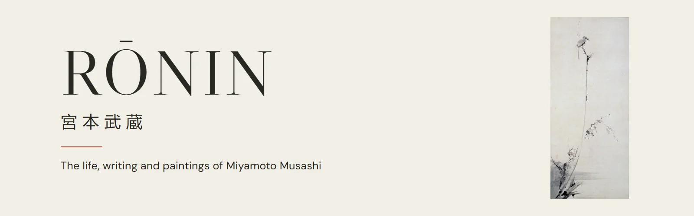

<p align="center">
  
</p>

<p align="center">
  <strong>By his own count, he won more than sixty duels. He also painted this.</strong><br>
  <sub>The life, writing and paintings of Miyamoto Musashi.</sub>
</p>

<p align="center"><a href="https://bytiagodev.github.io/ronin/"><strong>Read the site</strong></a></p>

---

I started reading about samurai and ended up reading about one man. Miyamoto Musashi fought his first duel at thirteen, crossed the water to face Sasaki Kojirō, spent decades moving between towns and patrons, and in his last years sat in a cave near Kumamoto writing a book about strategy. He also painted birds with a handful of ink strokes and left most of the paper empty around them.

RŌNIN is the place I wanted while I was reading about him: his life told as one story, his own words wherever they survive, and the paintings he left behind, all on one page.

## Earth · The ground

| | |
| --- | --- |
| His life | 9 chapters, from his first duel to his death in Kumamoto |
| His words | 8 short passages in the original Japanese, translated for the site |
| The Five Rings | 5 scrolls: Earth, Water, Fire, Wind and Void |
| The people in his story | Nobunaga, Ieyasu, Kojirō, Tadatoshi and Iori |
| His Japan | 5 turning points, from Honnōji in 1582 to Kumamoto in the 1640s |
| Artwork | Public-domain paintings and prints, each with its rights record |
| Journal | Notes written from any scroll, kept in the browser, exportable as text |
| Server, accounts, database | None |

## Water · The look

The site borrows its look from his paintings: ivory paper, black ink and one vermilion, with a lot of empty space. The hero is his own Shrike on a Withered Branch, not an illustration of him. Libre Caslon Display carries the headings and DM Sans the reading text. The page goes dark once, for the crossing to Ganryūjima, and the timeline darkens with it as you scroll past.

## Fire · The build

React and Vite, plain JavaScript and CSS. The story, quotations, people and turning points live in data modules, separate from the components that show them. The life timeline follows your reading as you scroll, profile pages use hash routes such as `#people/kojiro`, and the journal stores notes in `localStorage`, so nothing leaves your browser.

```sh
npm install
npm run dev
```

```sh
npm test              # content and journal tests
npm run test:browser  # desktop and mobile browser tests (needs: npx playwright install chromium)
npm run build
```

## Wind · The other schools

In the Five Rings, Wind is the scroll about other schools. Here it is about everyone whose work this site leans on: Japanese museums and municipal guides, the University of Tsukuba, transcriptions of the original Five Rings text, and the collections that keep the paintings and prints. Every chapter links its sources. Where the accounts disagree, about his birth, the number of his duels or what happened on Ganryūjima, the site says so once, in its own note.

Image records, rights and dimensions are listed in [public/images/figures/README.md](public/images/figures/README.md).

## Void · What remains

Code under the [MIT licence](LICENSE). The paintings and prints are in the public domain, as recorded for each file. DM Sans and Libre Caslon Display are used under the SIL Open Font License.

---

<p align="center">
  <sub>宮本武蔵 · RŌNIN © 2026 · Made by <a href="https://bytiago.com/en/">Tiago Teixeira</a></sub>
</p>
